# Shadow-Clerk Feature Tour

Shadow-Clerk is a background daemon that transcribes and translates your web meetings in real time: your own microphone and whatever comes out of your speakers. When the meeting ends it writes the minutes. While the meeting is still going, an AI assistant can flag open points for you, and you can even talk with Claude by voice. Nearly everything is driven from a browser dashboard. It runs on Linux (PipeWire / PulseAudio) and Windows.

Transcription plus LibreTranslate translation needs no external API and no Claude Code; it all runs locally. Everything else is optional.

The screenshots in this tour use a made-up dataset: a team called "acme" holding its weekly sync (「週次定例」) about 「おやつ便」 (Oyatsu-bin), a fictional snack subscription service. The UI is in Japanese and the translation target is English, so the English labels used below differ from what you see in the images. Installation and the full list of config keys live in the [README](../README.md).

## Starting up

```bash
clerk-daemon -d          # run in the background (logs go to daemon.log in the data directory)
clerk-util stop          # stop it
```

Run `clerk-daemon` without `-d` to keep it in the foreground; `Ctrl+C` stops it. Once it's up, open <http://localhost:8765> in your browser.

The dashboard is laid out like this:

- **Header**: the current state ("Transcribing (today's notes)", "In a meeting"), **▶ Start meeting**, **🌐 Translate**, **Talk with Claude**, the recognition language, mute toggles for **your voice** / **their voice**, **More ▾**, **🪟 View ▾**, **Simple** / **Advanced**, and the light/dark toggle
- **Left pane**: pick a record from the **Dates** / **Meetings** / **🔍 Search** tabs
- **Center**: the open transcript. **🪟 View** puts the translation next to it, or shows the minutes or the AI assistant's screen in the middle instead
- **Right pane**: **📝 Minutes** / **💡 AI advice**
- **Bottom drawer** (**Advanced** only): the AI assistant screen, the Talk with Claude screen, the activity log and voice command responses

**Simple** hides what most people never use (PTT, voice commands, spoken language, file deletion, the bottom drawer); **Advanced** shows everything. On first launch a **Welcome** dialog walks you through installing the skills for AI agents and the settings worth checking first.

## Real-time transcription and translation

While the daemon runs, whatever is said goes into "today's notes" (the daily transcript), even when no meeting has been started. Lines from your microphone are tagged `自分` (me), lines from the speaker side (the other participants) are tagged as theirs, and every line carries a timestamp.

For a meeting, click **▶ Start meeting**. One dialog sets the meeting name, the spoken language and whether the AI assistant should watch the meeting.

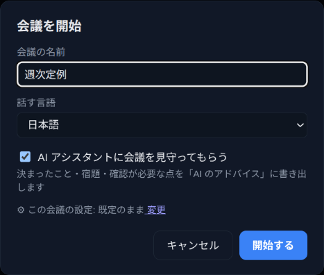

During the meeting, recording switches to a file of its own and the header shows a red **End meeting** button. Turn on **🌐 Translate** and the translation appears next to the transcript.

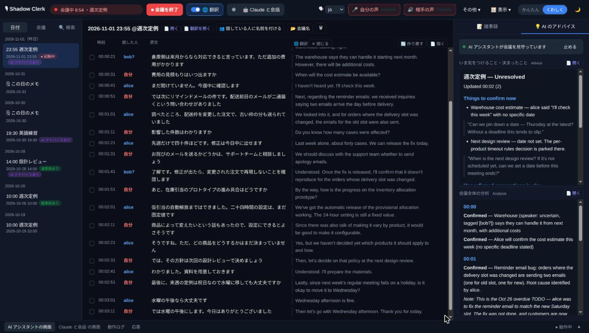

- **Speech recognition**: Whisper by default; for Japanese you can switch to ReazonSpeech k2 or Kotoba-Whisper
- **Translation provider**: LibreTranslate (local), any OpenAI-compatible API, or Claude (`claude -p`)
- **Interim transcription**: turn on `interim_transcription` to see partial text before an utterance is finalized
- **Typo correction**: a T5 model can fix recognition errors before the text goes to LibreTranslate (`spell-check` extra). With an LLM provider, there's also a step that has the model re-read the Japanese in hiragana to catch homophone mix-ups
- **Mishearing hints** (Japanese, `kana-hint` extra): a second model listens to the same audio in kana and, where a word's reading disagrees with what it heard, appends the kana it heard, as in `リプロイ(でぷろい?)`. The transcript itself is left as is
- **Glossary**: translation and summaries use the [glossary](#glossary-and-misheard-pairs). In the screenshot above, 配送枠 comes out as "delivery slot"
- **Mute**: **your voice** / **their voice** in the header pause transcription for either side. The bars next to them are input levels

You can also start a meeting with a voice command ("会議開始" / "会議終了") or `clerk-util command start_meeting`, or let Google Calendar integration start and end meetings to match your events.

### Switching the view

**🪟 View** chooses what fills the middle: Transcript / + Translation / Translation only / Minutes & AI advice enlarged / AI assistant screen (Alt+1 to Alt+5). It also toggles the side and bottom panels and sets the text size.

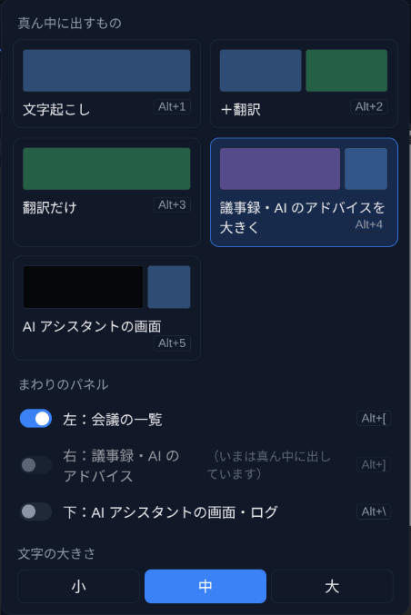

## Minutes

After the meeting, generate minutes from **📝 Minutes** in the right pane, or set `auto_summary: true` to have them written automatically when the meeting ends. You can copy, reload or regenerate them, and **📄 Open** opens the Markdown file.

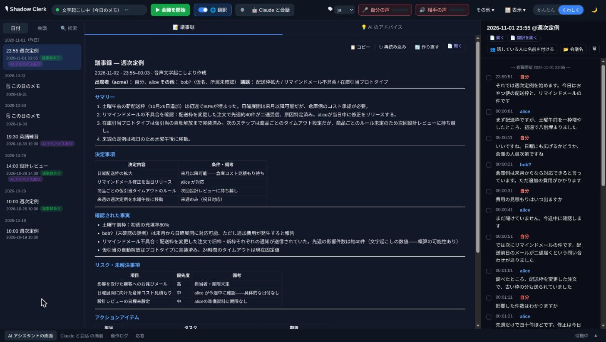

`summary_language` sets the language of the minutes and `summary_length` how long they should be (from half a page to five A4 pages). Drop a `summary_template.md` into the data directory to make them follow your own format. If the AI assistant is still running when the meeting ends, it writes the minutes instead (`auto_summary_via_console`, on by default). When speakers have names and groups, the attendees and their groups go into the minutes too.

## AI advice (real-time AI analysis)

You can have an AI assistant sit in on the meeting and pick out the open points as the discussion unfolds. The assistant is a real Claude Code (or Codex) session that follows the transcript with the bundled `/clerk-meeting-helper` skill.

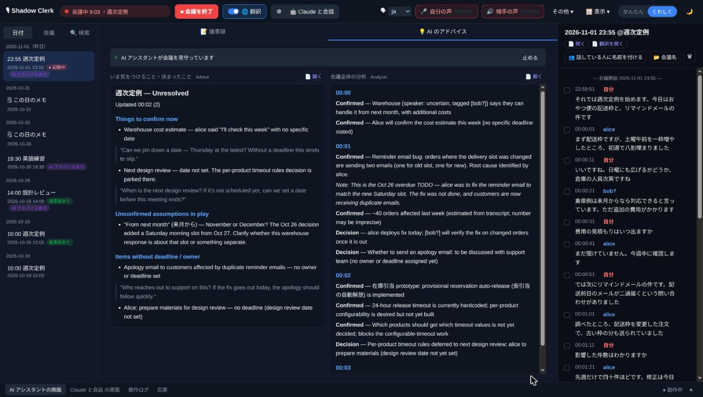

**💡 AI advice** shows two files:

- **Watch out for / decided** (Advice, `advice-*.md`): what is still open. It is grouped under headings such as "Things to confirm now", "Unconfirmed assumptions" and items without an owner or deadline, and each item is phrased so you can say it out loud right away. The file is rewritten from scratch every time, so items disappear once they're settled
- **Whole-meeting analysis** (Analysis, `analysis-*.md`): what has been established. Findings and decisions pile up under time headings, ready to feed into the minutes

The skill writes in your translation language, which is why the analysis of this Japanese meeting comes out in English. It also reads the previous minutes, so it notices when last time's to-do is still open (the Note in the screenshot).

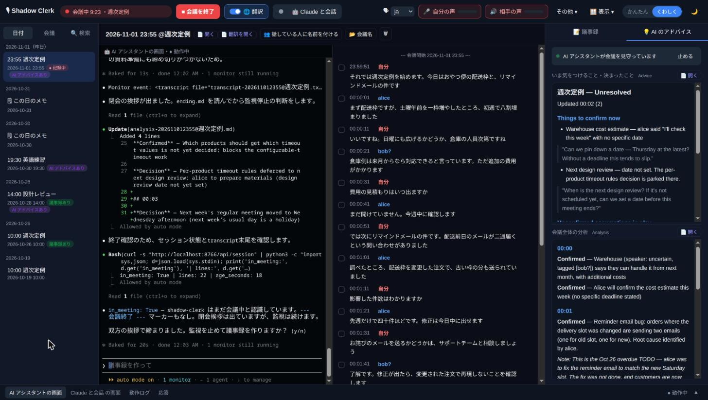

To use it:

1. **Install Claude Code or Codex.** `ai_assistant_command` (default `claude`) decides what gets launched
2. **Install the skills**, either from the Welcome dialog or from the command line. All bundled skills are installed together

   ```bash
   clerk-util install-skill                  # ~/.claude/skills/ (Claude Code)
   clerk-util install-skill --target agents  # ~/.agents/skills/ (Codex and others)
   ```

3. **Start it.** Tick "Have the AI assistant watch the meeting" in the Start meeting dialog and it starts along with the meeting. To start it later, use the start button in **💡 AI advice**

The assistant keeps running after the meeting ends, so the same session, with the whole discussion still in context, can write the minutes. Stop it with **Stop**. Permission prompts for file edits and commands follow your usual Claude Code settings. Topics that must never be analyzed can be listed in `forbid-ai-analyze.txt` in the data directory.

## Talk with Claude

Click **Talk with Claude** in the header to talk with Claude by voice. Claude's replies are spoken with VOICEVOX, and what you say is transcribed as usual and passed to Claude.

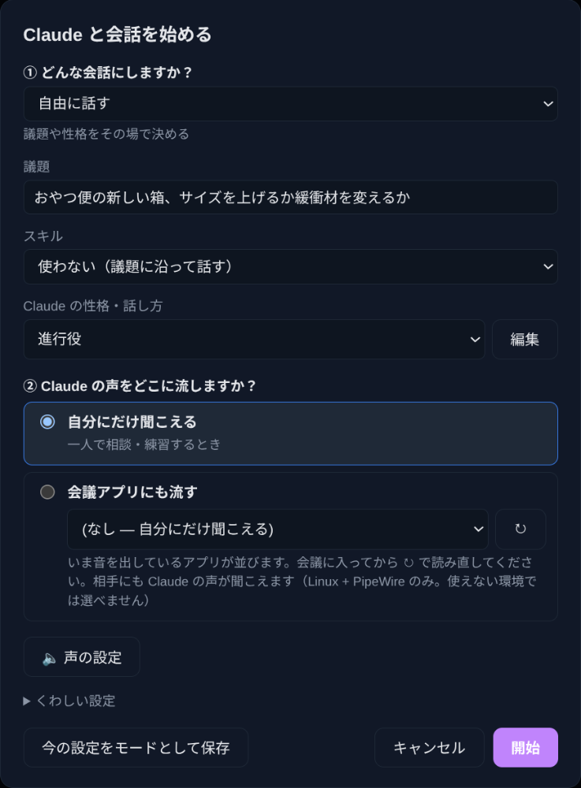

You need the Claude Code CLI, a VOICEVOX engine running as a separate process (`http://localhost:50021` by default), and headphones. The dialog asks for:

- **What kind of conversation?**: besides free talk, **English practice**, **Japanese Lesson** and **Meeting retrospective** are built in. You can save the current settings as a mode of your own
- **Topic**: optional. If you leave it blank, Claude opens by asking what you'd like to talk about
- **Skill**: Claude switches to the chosen skill (`clerk-practice`, `clerk-conversation-retrospective`, `voicevox-sing`) first
- **Claude's character**: a named description of Claude's character and how it should respond
- **Voice settings**: pick the VOICEVOX speaker and tune speed, pitch, intonation and volume, with a preview

How the talk works:

- **It all goes into the transcript.** Claude's lines are written as `Claude` and get translated too, so you can read the discussion back later
- **You can cut in.** Claude speaks in short sentences, so you can interrupt between them. Say a stop word such as "stop" or "wait" and playback stops
- **Works alongside the meeting assistant.** If `/clerk-meeting-helper` is analyzing the same transcript, Claude also reads its Advice and brings up a point when the conversation goes quiet
- **Two engines.** By default Claude runs as the `clerk-talk` skill in the **Talk with Claude screen** at the bottom, where it can also edit files or run commands for you, with the usual permission prompts. `talk_engine: headless` switches to a background `claude -p` instead

**Sending Claude's voice into a meeting app (Linux, PipeWire).** Pick your meeting app under **Also into the meeting app**. Claude's speech is then wired into that app's microphone input, so the other participants hear it alongside your own voice. In this mode the other side is transcribed as well, so Claude can follow what they say. While someone is talking, Claude waits for them to finish before it speaks.

### Language practice

Ask for it during a talk ("I want to practice English"), or choose **English practice** under **What kind of conversation?**, and Claude switches to the bundled `clerk-practice` skill. It starts a practice meeting (`英語練習` for English), reads your earlier sessions, proposes today's practice, and drills pronunciation, conversation, listening and real-life conversation by voice.

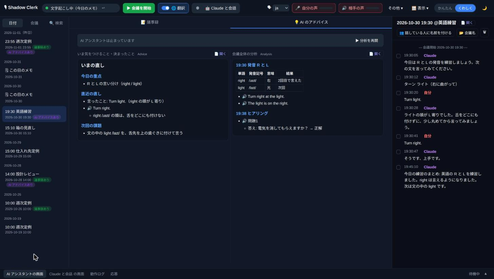

- Corrections go into **Advice**, the practice record and example sentences into **Analysis**
- Click a line starting with 🔊 to hear it in that language (the browser's Web Speech API). Listening quizzes hide the sentence and only show "問題1" (question 1)
- For absolute beginners there's alphabet practice too. A single letter often isn't picked up by speech recognition, so you say several letters in a row
- With the `pronounce` extra, English pronunciation is judged phoneme by phoneme
- At the end Claude speaks a "today's practice summary", which the next session picks up from

## Naming the speakers

With `speaker_diarization` (`diarization` extra) on, the other participants are told apart as `相手A`, `相手B`… (them A, them B). After the meeting, **👥 Name the speakers** gives those labels real names.

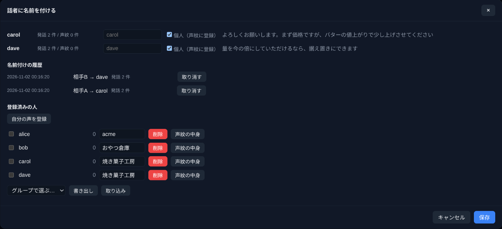

- Naming rewrites the labels in the transcript and translation. Each naming can be undone from the **naming history**
- With `speaker_enrollment` on, the voice is saved as a voiceprint. From the next meeting on, voices are matched while recording and names appear as `alice` (confident) or `bob?` (tentative). A name recognized during a meeting is only added to the voiceprint once you confirm it afterwards
- **Groups** (companies, organizations) are set in the list of registered people. With two or more groups, the minutes sort requests, agreements and to-dos by group
- Select lines and click **👤 Fix the speaker** to reassign them to someone else
- Voiceprints can be exported and handed to someone else (get the person's consent). They never leave the data directory otherwise and are never sent to an LLM. Audio is not stored

## Finding past records

The three tabs in the left pane open older records.

- **Dates**: each day's notes and that day's meetings. Meetings with minutes or AI advice carry a badge
- **Meetings**: meeting files grouped by meeting name. Pick a name to see its sessions. ✏ renames the meeting and ⚙ opens its settings

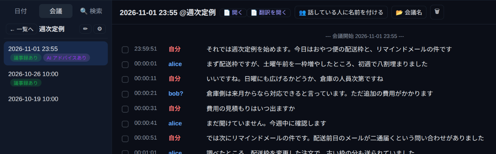

- **🔍 Search**: search transcripts, translations and minutes by keyword. Narrow it down by scope and date; results are grouped by meeting with the matches highlighted

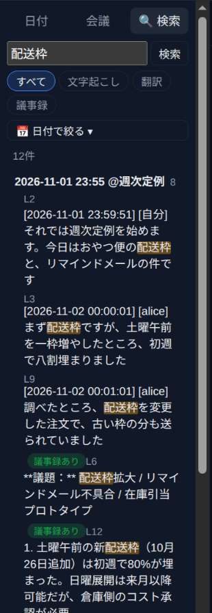

## Extracting a meeting afterwards

Forgot to press Start meeting? You can still carve a meeting out of the day's notes. The notes are shown split into conversations, and **✂ Save as a meeting** on a conversation turns it into a meeting as is. **✂ Split everything automatically** divides the whole day into meetings at the gaps in conversation.

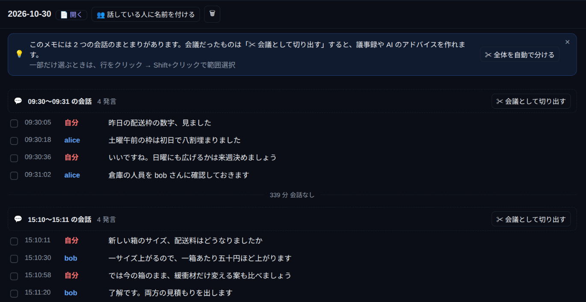

Click a line (Shift+click for a range) to select it, and an action bar appears at the bottom: **✂ Save as a meeting**, **👤 Fix the speaker**, **📋 Copy** and **🗑 Delete**. Deleting lines removes their translation lines too.

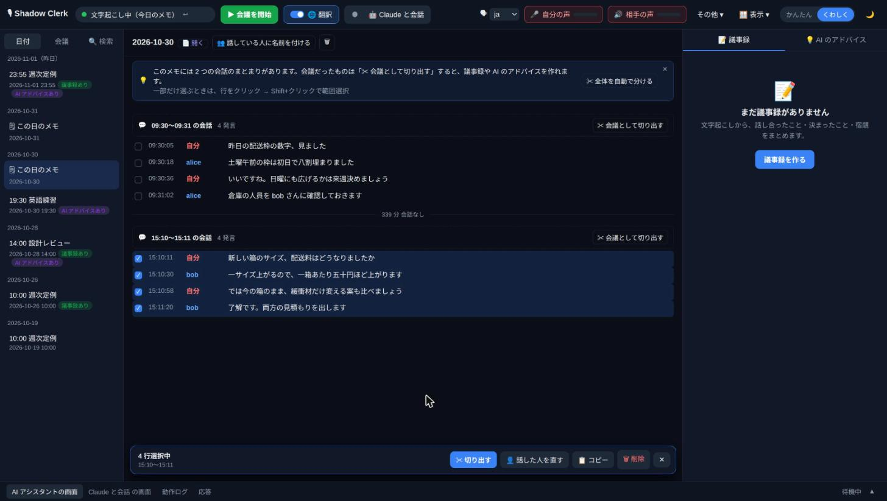

The extract dialog asks what to extract (split the whole day automatically / split the selection automatically / make the selection one meeting as it is) and how to save it (as another session of a recurring meeting / with a new meeting name / without a name / appended to an existing meeting file).

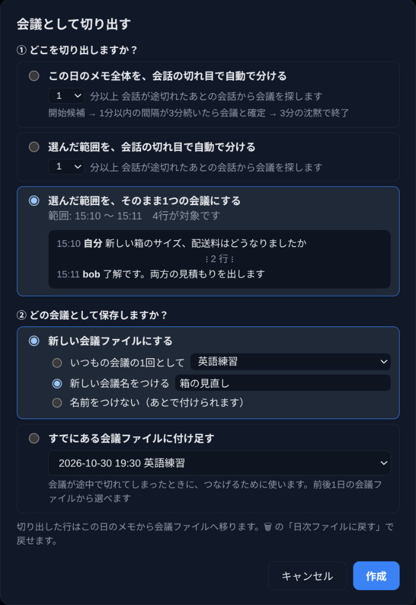

Extracted lines move from the day's notes into the meeting file. "Move back to the daily file" under the file's 🗑 undoes it.

## Per-meeting settings and where records live

Records go into one folder per meeting (`<category>/<meeting name>/`); records without a meeting name go into `<category>/@dates/YYYY-MM/`. **More ▾ → Meeting settings** changes the following per meeting. Select several meetings to set the same value on all of them at once.


- **AI assistant**: whether to start analysis when the meeting starts, and the assistant's working folder (a Git repository, for example)
- **Where records live**: the category (`private` / `sharable` / `isolated` by default). Changing it moves the meeting's earlier records into that category as well. You can also list folders the AI may consult
- **Publishing**: whether the minutes may be published to an external service

Categories are just locations and carry no behavior of their own. The list of categories can be changed under **Advanced** in the settings.

## Glossary and misheard pairs

**More ▾ → Glossary** opens `glossary.txt` for editing. It's a TSV with one column per language (`ja`, `en`, …) plus `reading` and `note`.

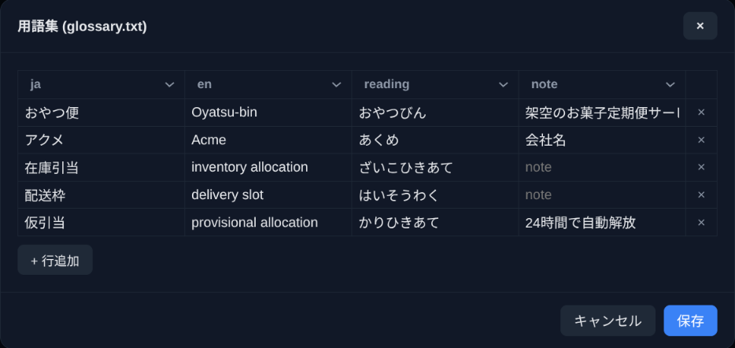

- It is passed to the translation and summary prompts, which keeps terms consistent and helps fix misrecognitions
- When a `reading` shows up verbatim in the recognized text, it is replaced with the term itself

Separately, `misheard.tsv` collects pairs of "what was actually said" and "how it was misheard". These are never applied to the transcript. Instead, the bundled skills read them as hints when interpreting what people said, and add new pairs on their own as they spot them during a meeting.

## Voice commands

- **PTT (recommended)**: hold the PTT key (default `f23`, meant to be mapped to something like the Menu key with a key remapper) and say a command such as 「会議開始」 or 「翻訳開始」
- **Wake word**: without the key, say the wake word first, as in 「シェルク、会議開始」. Recognition is less reliable, so PTT is the safer choice
- **Custom commands**: **More ▾ → Voice commands** lets you register pairs of a regex pattern and a shell command

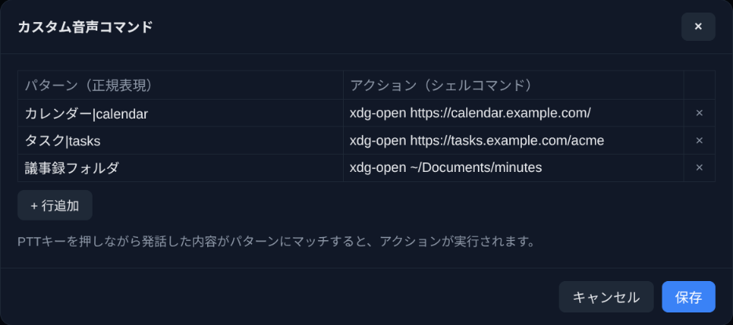

- **Asking the LLM**: if no command matches and an LLM is configured, what you said is sent to the LLM as a question and the answer appears under **Response** in the bottom drawer

PTT, voice commands and the spoken language appear in **More ▾** in **Advanced** mode.

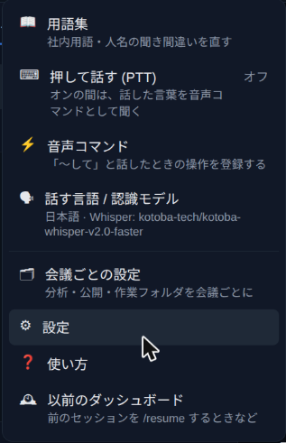

## Settings

**More ▾ → ⚙ Settings** opens the settings dialog. Almost everything can be changed there, and it is saved to `config.yaml`. The items are split into the tabs Basic / Transcription / Translation & summary / AI & API / Talk & pronunciation / Integrations.

**Simple** shows only the commonly used items.

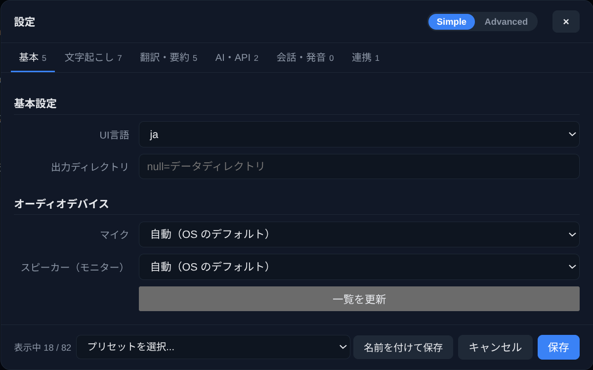

**Advanced** shows everything. You can also save the current settings as a named preset and load it later.

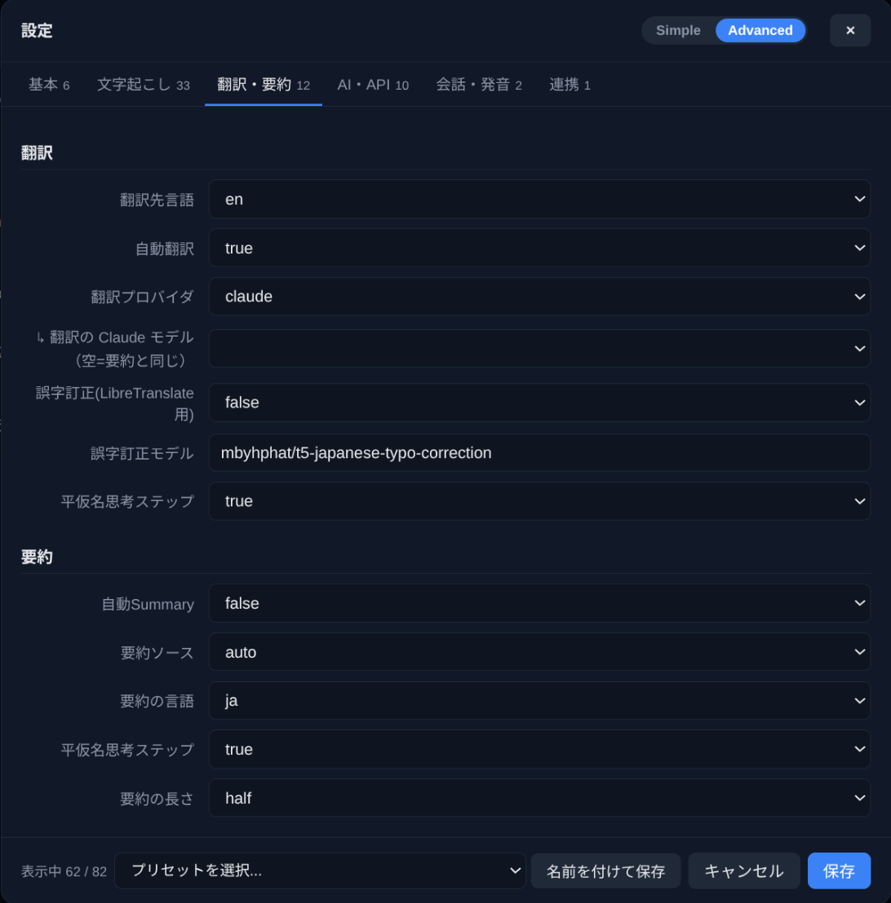

The microphone and the speaker (monitor) are chosen by name; a device plugged in later appears after **Refresh list**. Every config key and its default is listed in the README's [Configuration](../README.md#configuration) section. You can also change settings from the command line with `clerk-util read-config` and `clerk-util write-config-value <key> <value>`.

## Google Calendar and browser screenshots

**Google Calendar**: install the `gcal` extra and authorize with OAuth, and the daemon checks your calendar periodically and starts and ends meetings to match your events. The event title becomes the meeting name, and invitees are shown as expected attendees above the minutes. See [docs/google-calendar-setup.md](google-calendar-setup.md) for the setup.

**Browser screenshots**: the Chrome extension in [`extension/`](../extension/) captures the visible tab (a screen share, for example), saves the image in the meeting's folder and adds a `[画面]` (screen) line to the transcript being recorded. Screens and speech end up on the same timeline, so a remark like "this slot here" still makes sense later. Details are in [extension/README.md](../extension/README.md).

## Data directory

Records and settings live in `~/.local/share/shadow-clerk/` (`%APPDATA%\shadow-clerk` on Windows). The main files:

| File | Contents |
| --- | --- |
| `<category>/<meeting name>/` | One folder per meeting, holding its transcripts, translations, minutes and AI advice |
| `<category>/@dates/YYYY-MM/` | Daily notes and unnamed meetings |
| `transcript-YYYYMMDD.txt` | Daily transcript |
| `transcript-YYYYMMDDHHMM[@name].txt` | Meeting transcript |
| `transcript-…-<lang>.txt` | Translation (e.g. `-en`) |
| `summary-….md` | Minutes |
| `advice-….md` / `analysis-….md` | The AI assistant's open items / established facts |
| `glossary.txt` | Glossary (TSV) |
| `misheard.tsv` | Misheard pairs collected by the skills |
| `speaker_names.json` / `voiceprints.json` | Speaker names and groups / voiceprints |
| `meeting.yaml` | Per-meeting settings |
| `config.yaml` | Configuration |

The complete list is in the README's [File structure](../README.md#file-structure) section.

## Wrap-up

| Feature | What it does |
| --- | --- |
| Real-time transcription and translation | Whisper / ReazonSpeech / Kotoba-Whisper with LibreTranslate / OpenAI-compatible API / Claude. Can run fully local |
| Meetings and minutes | Start and end from a button, by voice or from your calendar. Minutes on demand or automatically |
| AI advice | Claude Code or Codex writes down open points and settled facts while the meeting runs |
| Talk with Claude | Talk with Claude in a VOICEVOX voice, including language practice and meeting retrospectives. On Linux + PipeWire, Claude can join your meeting app too |
| Speaker names and voiceprints | Tell the other participants apart; once named, they are recognized by voice in later meetings |
| Organizing records | Dates, Meetings and Search tabs, extracting meetings from conversations, per-meeting folders and categories |
| Voice commands | PTT, wake word, custom commands, questions to the LLM |
| Glossary and misheard pairs | Better translations and summaries, and context hints for the skills |
