# Shadow-Clerk Feature Tour

Shadow-Clerk は、Web 会議の音声（自分のマイクとスピーカー出力）をリアルタイムに文字起こし・翻訳する常駐デーモンです。会議が終われば議事録を作り、会議中は AI アシスタントに論点を拾わせ、Claude と声で話すこともできます。操作はほぼすべてブラウザのダッシュボードから行います。Linux（PipeWire / PulseAudio）と Windows で動きます。

文字起こしと LibreTranslate による翻訳だけなら、外部 API も Claude Code も要りません。すべてローカルで完結します。それ以外の機能はすべてオプションです。

このツアーのスクリーンショットは、架空のチーム「acme」が架空のおやつ定期便サービス「おやつ便」の週次定例をしている、という設定で撮っています。UI は日本語、翻訳先は英語です。インストール手順や設定キーの一覧は [README](../README.ja.md) にあります。

## 起動

```bash
clerk-daemon -d          # バックグラウンドで起動（ログはデータディレクトリの daemon.log）
clerk-util stop          # 停止
```

`-d` を付けずに `clerk-daemon` と打てばフォアグラウンドで動き、`Ctrl+C` で止まります。起動したらブラウザで <http://localhost:8765> を開きます。

ダッシュボードは次の部分からできています。

- **ヘッダ**: いまの状態（「文字起こし中（今日のメモ）」「会議中」）、**▶ 会議を開始**、**🌐 翻訳**、**Claude と会話**、認識する言語、**自分の声** / **相手の声** のミュート、**その他 ▾**、**🪟 表示 ▾**、**かんたん** / **くわしく**、ライト/ダークの切り替え
- **左ペイン**: **日付** / **会議** / **🔍 検索** の3タブで記録を選ぶ
- **中央**: 開いている文字起こし。**🪟 表示** で翻訳を並べたり、議事録や AI アシスタントの画面を大きく出したりできる
- **右ペイン**: **📝 議事録** / **💡 AI のアドバイス**
- **下部のドロワー**（**くわしく** のときだけ）: AI アシスタントの画面、Claude と会話の画面、動作ログ、音声コマンドの応答

**かんたん** は多くの人が使わない機能（PTT・音声コマンド・話す言語・ファイルの削除・下部のドロワー）を隠し、**くわしく** はすべて出します。初回起動時は **ようこそ** ダイアログが開き、AI エージェント向けのスキルの導入と、最初に見ておくとよい設定を案内します。

## リアルタイム文字起こしと翻訳

デーモンが動いていれば、会議を始めていなくても、話した内容は「今日のメモ」（日付ごとの文字起こし）に流れていきます。マイク側の発言は `自分`、スピーカー側（会議の相手）の発言は相手として、タイムスタンプ付きで記録されます。

会議のときは **▶ 会議を開始** を押します。会議の名前、話す言語、AI アシスタントに見守ってもらうかを1つのダイアログで決められます。

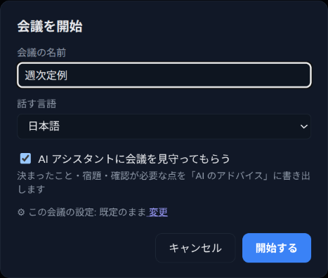

会議中は、その会議専用のファイルに記録が切り替わり、ヘッダは赤い **会議を終了** になります。**🌐 翻訳** をオンにすると、文字起こしの隣に訳が並びます。

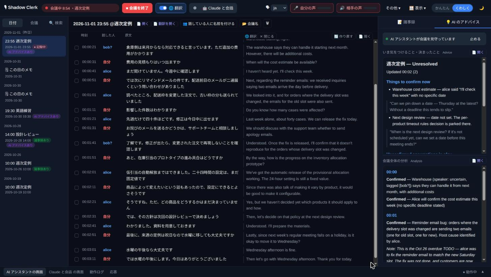

- **音声認識エンジン**: Whisper（既定）のほか、日本語なら ReazonSpeech k2 や Kotoba-Whisper を選べます
- **翻訳プロバイダ**: LibreTranslate（ローカル）、OpenAI 互換 API、Claude（`claude -p`）から選べます
- **中間文字起こし**: `interim_transcription` を有効にすると、発話が確定する前の途中経過も表示されます
- **誤字訂正**: LibreTranslate の前に T5 モデルで音声認識の誤字を直せます（`spell-check` extra）。LLM で翻訳する場合は、いったん平仮名で読み直させて同音の誤変換を拾わせるステップもあります
- **聞き間違いの目印**（日本語、`kana-hint` extra）: 別のモデルが同じ音声をかなで聞き取り、文字起こしの読みと食い違う語に `リプロイ(でぷろい?)` のように聞こえたかなを添えます。文字起こしそのものは書き換えません
- **用語集**: 翻訳と要約は[用語集](#用語集と聞き間違い)を参照します。上の画面では「配送枠」が「delivery slot」と訳されています
- **ミュート**: ヘッダの **自分の声** / **相手の声** で、どちらかの書き起こしを一時的に止められます。横のバーは入力レベルです

会議は音声コマンド（「会議開始」「会議終了」）や `clerk-util command start_meeting` でも始められます。Google カレンダー連携を有効にすれば、予定に合わせて自動で始まり、自動で終わります。

### 表示を切り替える

**🪟 表示** で、真ん中に出すものを 文字起こし / ＋翻訳 / 翻訳だけ / 議事録・AI のアドバイスを大きく / AI アシスタントの画面 から選べます（Alt+1〜Alt+5）。左右と下のパネルの表示・非表示、文字の大きさもここで変えます。

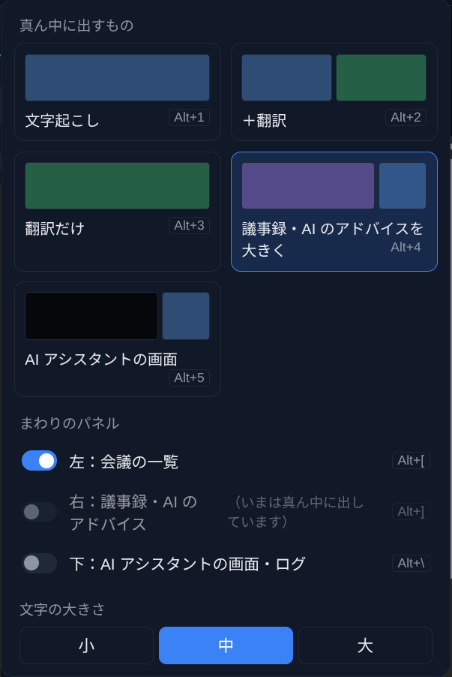

## 議事録

会議が終わったら、右ペインの **📝 議事録** で議事録を作れます。`auto_summary: true` なら会議終了時に自動で作られます。コピー・再読み込み・作り直しができ、**📄 開く** で Markdown ファイルとして開けます。

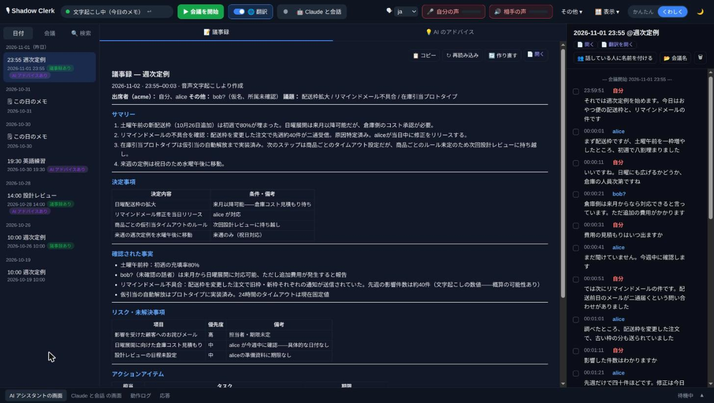

議事録の言語は `summary_language`、長さは `summary_length`（A4 換算で半ページから5ページ）で決まります。データディレクトリに `summary_template.md` を置けば、書式をそれに合わせられます。会議終了時に AI アシスタントが動いていれば、議事録はそのアシスタントが書きます（`auto_summary_via_console`、既定で有効）。話した人に名前やグループが付いていれば、出席者とグループも議事録に入ります。

## AI のアドバイス（リアルタイム AI 分析）

会議中、AI アシスタントを「同席」させて、進行中の議論から論点を拾わせることができます。アシスタントは本物の Claude Code（または Codex）で、同梱の `/clerk-meeting-helper` スキルを使って文字起こしを監視します。

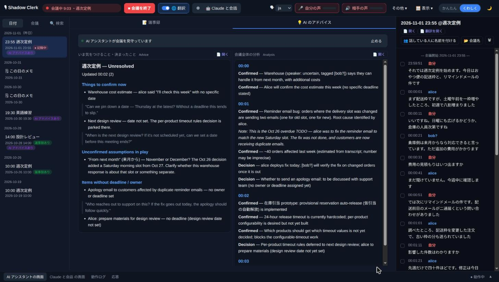

**💡 AI のアドバイス** には2つのファイルが表示されます。

- **いま気をつけること・決まったこと**（Advice、`advice-*.md`）: いま未解決のもの。「いま確認すべきこと」「未確認のまま進んでいる前提」「期限・担当が未定」などの見出しで、その場でそのまま言える文言として書かれます。毎回まとめ直して上書きされ、解決したものは消えていきます
- **会議全体の分析**（Analysis、`analysis-*.md`）: 確定した事実。時刻見出しの下に「判明」「決定」などが追記されていき、あとで議事録の素材になります

スキルは翻訳先の言語で書くので、上の画面では日本語の会議の分析が英語で出ています。前回の議事録も読むので、前回の宿題が片付いていないことにも気づきます（画面の Note）。

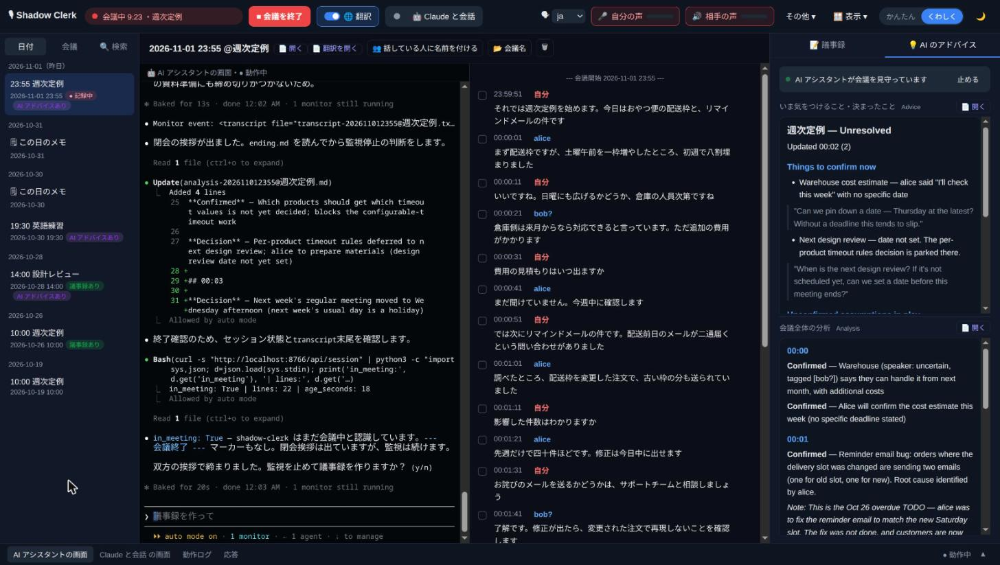

使い方:

1. **Claude Code か Codex を入れておく。** 起動するコマンドは `ai_assistant_command`（既定は `claude`）で決まります
2. **スキルを入れる。** ようこそ ダイアログから入れるか、コマンドで入れます。同梱スキルがまとめて入ります

   ```bash
   clerk-util install-skill                  # ~/.claude/skills/ (Claude Code)
   clerk-util install-skill --target agents  # ~/.agents/skills/ (Codex ほか)
   ```

3. **起動する。** 会議開始ダイアログで「AI アシスタントに会議を見守ってもらう」にチェックを入れておけば、会議と同時に起動します。あとからなら **💡 AI のアドバイス** の開始ボタンを押します

アシスタントは会議が終わっても止まりません。同じセッションがそのまま会議の流れを踏まえて議事録を書けるようにするためです。止めるときは **止める** を押します。アシスタントがファイル編集やコマンドを実行するときの許可は、通常の Claude Code の設定に従います。分析対象から外したい話題はデータディレクトリの `forbid-ai-analyze.txt` に書いておけます。

## Claude と会話

ヘッダの **Claude と会話** を押すと、Claude と声で話せます。Claude の発言は VOICEVOX で読み上げられ、自分の発言はいつもどおり文字起こしされて Claude に届きます。

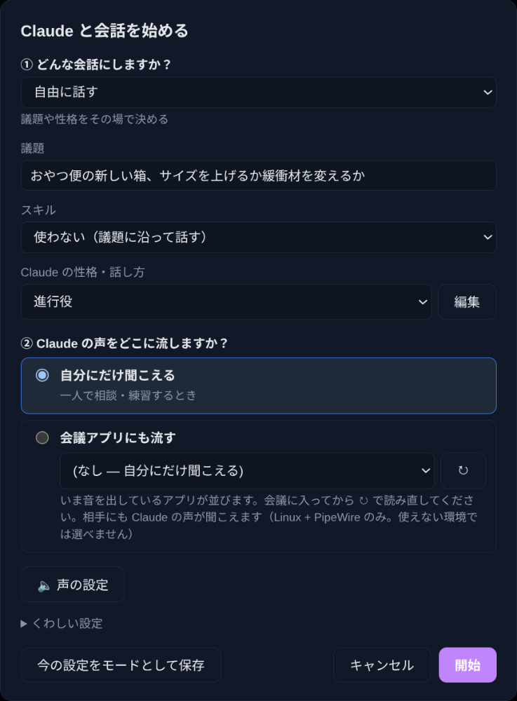

必要なものは Claude Code の CLI と、別プロセスで起動した VOICEVOX エンジン（既定は `http://localhost:50021`）、それにヘッドホンです。ダイアログでは次を決めます。

- **どんな会話にしますか？**: **自由に話す** のほか、最初から **英語の練習**・**Japanese Lesson**・**会議の振り返り** があります。今の設定を自分のモードとして保存することもできます
- **議題**: 空でも構いません。その場合は Claude が最初に何を話したいかを尋ねます
- **スキル**: 選ぶと、Claude は最初にそのスキル（`clerk-practice`・`clerk-conversation-retrospective`・`voicevox-sing`）に切り替えます
- **Claude の性格・話し方**: 性格や応答の仕方を名前を付けて保存しておけます
- **声の設定**: VOICEVOX の話者と、話速・音高・抑揚・音量を試聴しながら調整できます

会話は次のように進みます。

- **transcript に残る**: Claude の発言は `Claude` の行として文字起こしに書かれ、翻訳もされます。あとから議論を読み返せます
- **割り込める**: Claude は応答を短い文に区切って話すので、文の切れ目で割って入れます。「待って」「ストップ」のような制止の言葉を言えば読み上げが止まります
- **会議アシスタントと併用できる**: `/clerk-meeting-helper` が同じ文字起こしを分析していれば、その Advice も見ていて、会話が途切れたときに論点として切り出します
- **2つの動かし方**: 既定では Claude は下部の **Claude と会話 の画面** で `clerk-talk` スキルとして動き、ファイル編集やコマンド実行も通常の許可確認つきで頼めます。`talk_engine: headless` にすると裏で動く `claude -p` に切り替わります

**Claude の声を会議アプリに流す（Linux・PipeWire）。** **会議アプリにも流す** で会議アプリを選ぶと、Claude の読み上げがそのアプリのマイク入力につながり、相手にも自分の声と一緒に届きます。このときは相手の発言も文字起こしされるので、Claude は相手の話も追えます。誰かが話している間、Claude は話し終わるのを待ってから話します。

### 語学の練習

talk mode 中に「英語の練習をしたい」と頼むか、**どんな会話にしますか？** で **英語の練習** を選ぶと、Claude は同梱の `clerk-practice` スキルに切り替わります。練習用の会議（英語なら `英語練習`）を始め、前回までの練習を読んで今日の練習を提案し、発音・会話・ヒアリング・実践会話を声で練習します。

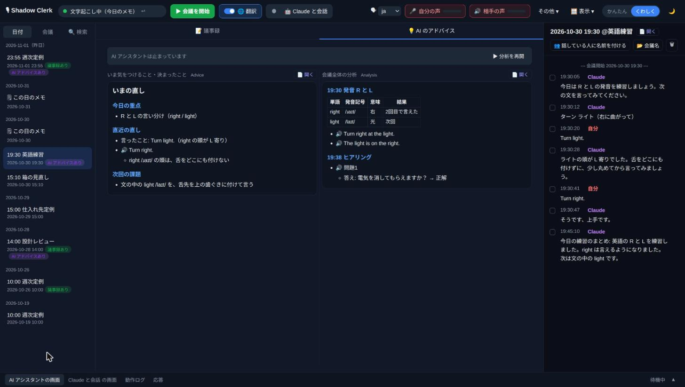

- 直しは **Advice** に、練習の記録と例文は **Analysis** に書かれます
- 🔊 で始まる行はクリックすると、その言語の声（ブラウザの Web Speech API）で読み上げられます。ヒアリングの出題では文を伏せて「問題1」とだけ出します
- 初心者向けに、アルファベットの練習もあります。1文字だけだと音声認識が拾わないことが多いので、何文字か続けて言わせます
- `pronounce` extra を入れると、英語の発音を音素ごとに判定してフィードバックします
- 最後に「今日の練習のまとめ」を話して、次の回の手がかりにします

## 話している人に名前を付ける

`speaker_diarization`（`diarization` extra）を有効にすると、相手側の参加者が `相手A`、`相手B`… と区別されます。会議のあと、**👥 話している人に名前を付ける** でラベルに名前を付けられます。

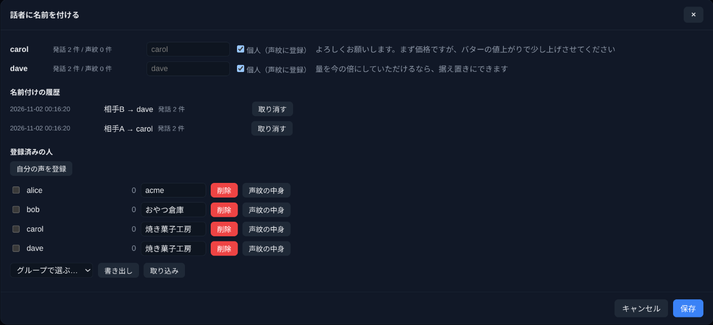

- 名前を付けると文字起こしと翻訳のラベルが書き換わります。**名前付けの履歴** から1件ずつ取り消せます
- `speaker_enrollment` が有効なら、その声が声紋として保存されます。次の会議からは、録音中に声紋と照合して `alice`（確定）や `bob?`（未確定）のように名前が出ます。会議中に識別した名前は、会議のあとで確かめたときだけ声紋に足されます
- **グループ**（会社・組織）は「登録済みの人」の一覧で設定します。グループが2つ以上あれば、議事録はグループ別に要望・合意・宿題を整理します
- 行を選んで **👤 話した人を直す** を押すと、別の話者に付け替えられます
- 声紋は書き出して他の人に渡せます（本人の同意を得てください）。声紋はデータディレクトリの外に出さず、LLM にも渡しません。音声は保存しません

## 過去の記録を探す

左ペインの3つのタブで過去の記録を開けます。

- **日付**: 日ごとのメモと、その日の会議です。議事録や AI のアドバイスがある会議にはバッジが付きます
- **会議**: 会議名ごとにまとめた会議ファイルです。会議名を選ぶとその回の一覧が開きます。✏ で会議名を変更でき、⚙ でその会議の設定を開けます

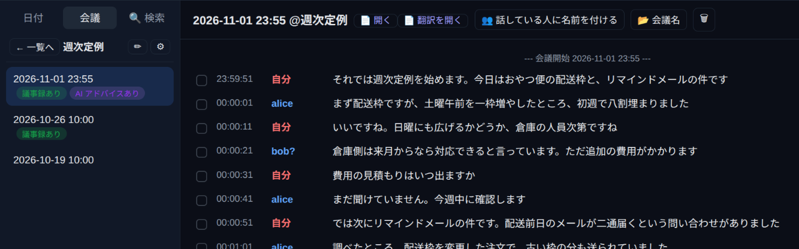

- **🔍 検索**: キーワードで文字起こし・翻訳・議事録を横断検索します。対象と日付で絞り込め、結果は会議ごとにまとまって、該当箇所が強調されます

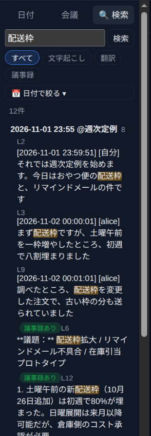

## あとから会議を切り出す

会議開始を押し忘れても、日付ごとのメモから会議を切り出せます。メモは会話のまとまりごとに区切って表示され、まとまりごとの **✂ 会議として切り出す** で、そのまま会議にできます。**全体を自動で分ける** を押せば、会話の切れ目で1日分をまとめて会議に分けます。

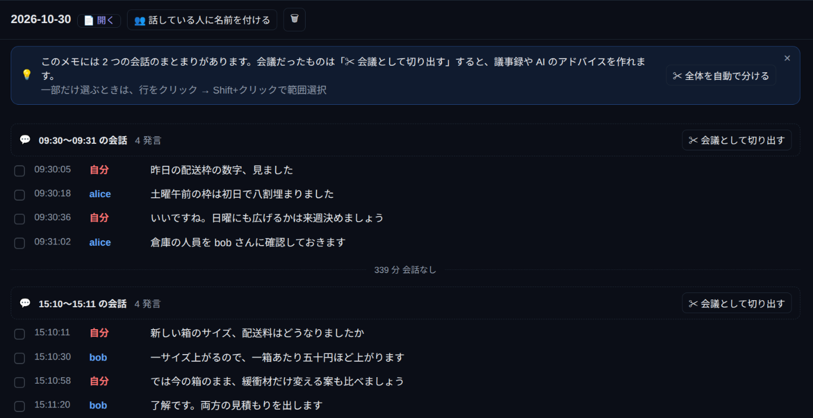

行をクリック（範囲は Shift+クリック）で選ぶと、下に操作のバーが出ます。**✂ 切り出す**・**👤 話した人を直す**・**📋 コピー**・**🗑 削除** ができます。削除すると、対応する翻訳の行も消えます。

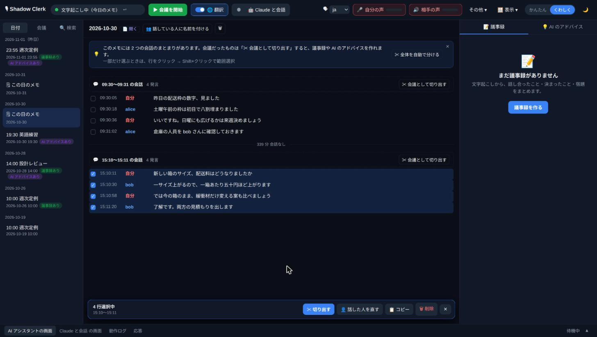

切り出しダイアログでは、どこを切り出すか（この日のメモ全体を自動で分ける / 選んだ範囲を自動で分ける / 選んだ範囲をそのまま1つの会議にする）と、どの会議として保存するか（いつもの会議の1回 / 新しい会議名 / 名前なし / すでにある会議ファイルに付け足す）を選びます。

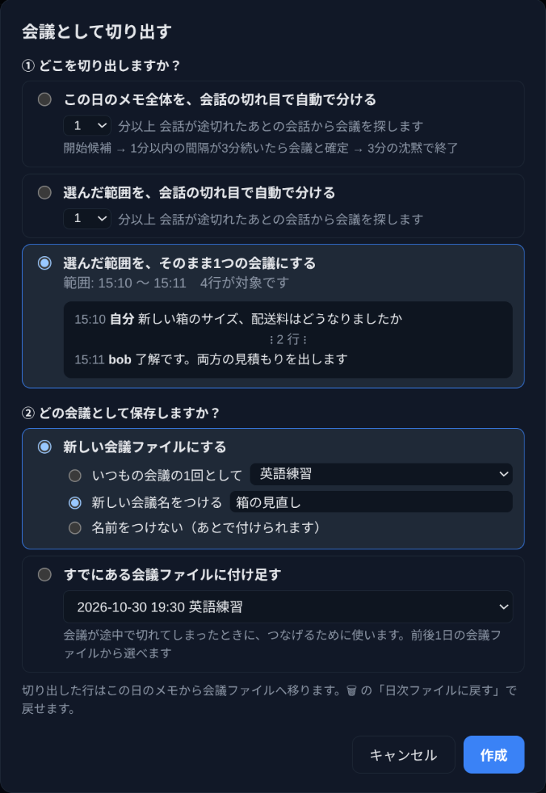

切り出した行は日付のメモから会議ファイルへ移ります。ファイルの 🗑 にある「日次ファイルに戻す」で元に戻せます。

## 会議ごとの設定と記録の置き場所

記録は会議ごとのフォルダ（`<区分>/<会議名>/`）に入ります。会議名のない記録は `<区分>/@dates/YYYY-MM/` に入ります。**その他 ▾ → 会議ごとの設定** で、会議ごとに次を変えられます。複数の会議を選べば、まとめて同じ値を設定できます。


- **AI アシスタント**: 会議開始時に分析を始めるか、アシスタントの作業フォルダ（Git リポジトリなど）
- **記録の置き場所**: 区分（既定は `private` / `sharable` / `isolated`）。変えると、その会議のこれまでの記録もその区分へ移ります。AI が参考にしてよいフォルダも指定できます
- **公開**: 議事録を外部サービスに公開してよいか

区分は置き場所にすぎず、振る舞いは持ちません。区分の一覧は設定の **Advanced** で変えられます。

## 用語集と聞き間違い

**その他 ▾ → 用語集** で `glossary.txt` を編集できます。言語ごとの表記（`ja`, `en` …）と `reading`（読み）、`note` の列を持つ TSV です。

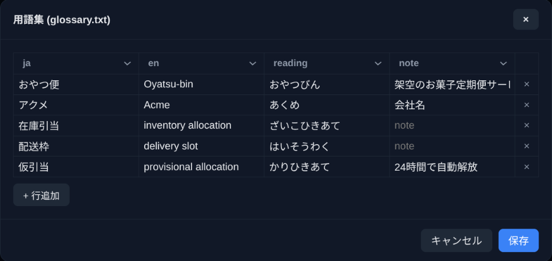

- 翻訳と要約のプロンプトに渡され、訳語の統一や誤変換の修正に使われます
- 文字起こしの結果に `reading` 列の読みがそのまま現れたら、その用語の表記に置き換えます

用語集とは別に、`misheard.tsv` には「実際の語」と「聞き間違えた表記」の対が貯まっていきます。これは文字起こしには適用されず、同梱スキルが発言を読み解く手がかりとして読みます。スキルは会議中に新しい崩れを見つけると、自分でこのファイルに追記していきます。

## 音声コマンド

- **PTT（推奨）**: PTT キー（既定は `f23`。キーリマッパーで Menu キーなどに割り当てる前提）を押しながら「会議開始」「翻訳開始」などと話すと、コマンドとして実行されます
- **ウェイクワード**: キーを使わずに「シェルク、会議開始」のように話すこともできます。誤認識が多いので PTT のほうが確実です
- **カスタムコマンド**: **その他 ▾ → 音声コマンド** から、正規表現のパターンと実行するシェルコマンドの組を登録できます

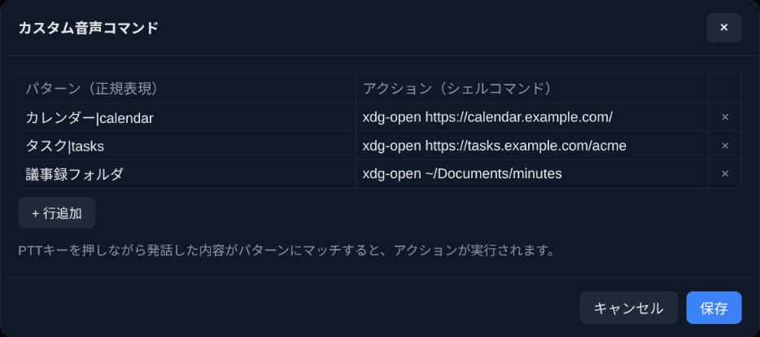

- **LLM への質問**: どのコマンドにも一致せず、LLM が使える設定なら、話した内容が LLM への質問として送られ、回答が下部のドロワーの **応答** に表示されます

PTT・音声コマンド・話す言語は、**くわしく** のときに **その他 ▾** に出ます。

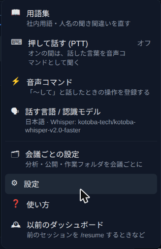

## 設定

**その他 ▾ → ⚙ 設定** で設定ダイアログが開きます。ほとんどの項目はここから変えられ、`config.yaml` に保存されます。項目は 基本 / 文字起こし / 翻訳・要約 / AI・API / 会話・発音 / 連携 のタブに分かれています。

**Simple** はよく使う項目だけを出します。

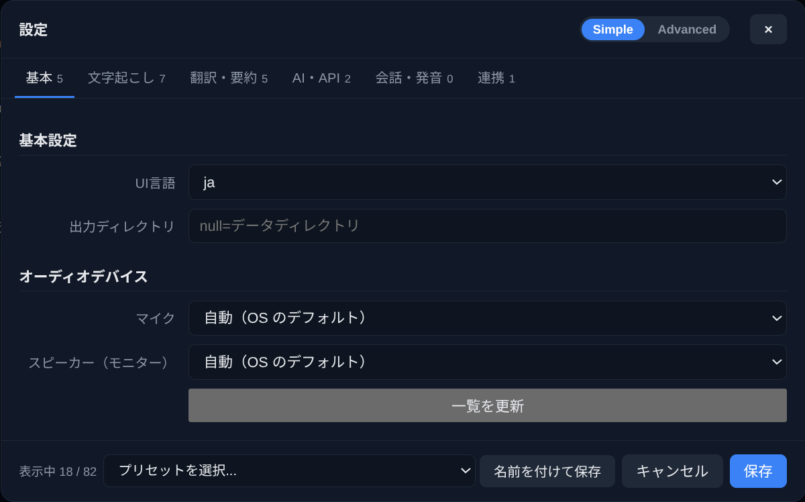

**Advanced** にするとすべての項目が出ます。今の設定に名前を付けてプリセットとして保存し、あとで呼び出すこともできます。

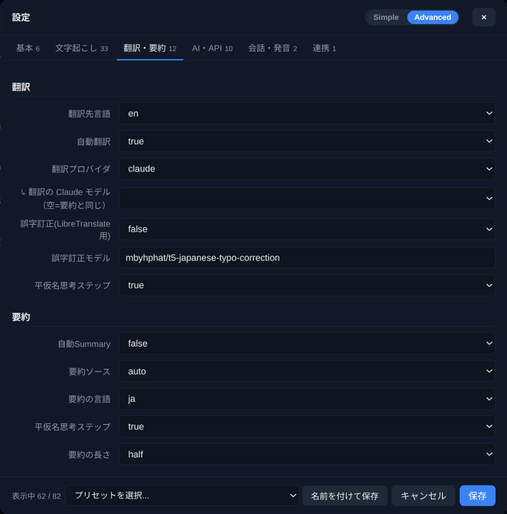

マイクとスピーカー（モニター）は名前で選びます。あとから挿したデバイスは **一覧を更新** で現れます。すべての設定キーと既定値は README の[設定](../README.ja.md#設定)にあります。`clerk-util read-config` / `clerk-util write-config-value <key> <value>` でコマンドラインからも変えられます。

## Google カレンダーとブラウザのスクリーンショット

**Google カレンダー連携**: `gcal` extra を入れて OAuth 認証すると、デーモンがカレンダーを定期的に確認し、予定の時刻に合わせて会議を自動で開始・終了します。会議ファイルには予定のタイトルが会議名として付き、招待者は参加予定者として議事録の上に表示されます。設定方法は [docs/google-calendar-setup.ja.md](google-calendar-setup.ja.md) を参照してください。

**ブラウザのスクリーンショット**: [`extension/`](../extension/) の Chrome 拡張で表示中のタブ（画面共有など）をキャプチャすると、画像が会議のフォルダに保存され、録音中の文字起こしに `[画面]` 行が1行加わります。発言と画面が同じ時系列に並ぶので、「この枠のところ」といった発言もあとから読み解けます。詳しくは [extension/README.md](../extension/README.md) にあります。

## データディレクトリ

記録や設定は `~/.local/share/shadow-clerk/`（Windows では `%APPDATA%\shadow-clerk`）に保存されます。主なファイル:

| ファイル | 内容 |
| --- | --- |
| `<区分>/<会議名>/` | 会議ごとのフォルダ。文字起こし・翻訳・議事録・AI のアドバイスが入る |
| `<区分>/@dates/YYYY-MM/` | 日付ごとのメモと名前のない会議 |
| `transcript-YYYYMMDD.txt` | 日付ごとの文字起こし |
| `transcript-YYYYMMDDHHMM[@会議名].txt` | 会議ごとの文字起こし |
| `transcript-…-<lang>.txt` | 翻訳（例: `-en`） |
| `summary-….md` | 議事録 |
| `advice-….md` / `analysis-….md` | AI アシスタントの未解決事項 / 確定事項 |
| `glossary.txt` | 用語集（TSV） |
| `misheard.tsv` | スキルが集めた聞き間違いの対 |
| `speaker_names.json` / `voiceprints.json` | 話者の名前・グループ / 声紋 |
| `meeting.yaml` | 会議ごとの設定 |
| `config.yaml` | 設定ファイル |

全体の一覧は README の[ファイル構成](../README.ja.md#ファイル構成)にあります。

## まとめ

| 機能 | 内容 |
| --- | --- |
| リアルタイム文字起こし・翻訳 | Whisper / ReazonSpeech / Kotoba-Whisper、LibreTranslate / OpenAI 互換 API / Claude。ローカルだけでも完結 |
| 会議と議事録 | ボタン・音声・カレンダーで開始と終了。議事録は自動でも手動でも |
| AI のアドバイス | Claude Code / Codex が会議中に未解決の論点と確定事項を書き出す |
| Claude と会話 | VOICEVOX の声で Claude と話す。語学の練習や会議の振り返りも。Linux + PipeWire なら会議アプリにも参加させられる |
| 話者の名前と声紋 | 相手を区別し、名前を付ければ次の会議から声で名前が出る |
| 記録の整理 | 日付・会議・検索タブ、会話のまとまりからの切り出し、会議ごとのフォルダと区分 |
| 音声コマンド | PTT・ウェイクワード・カスタムコマンド・LLM への質問 |
| 用語集と聞き間違い | 翻訳・要約の精度を上げ、スキルが文脈を読み解く手がかりにする |
