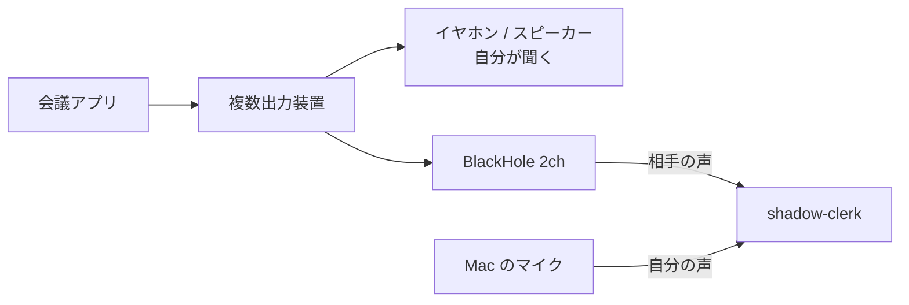
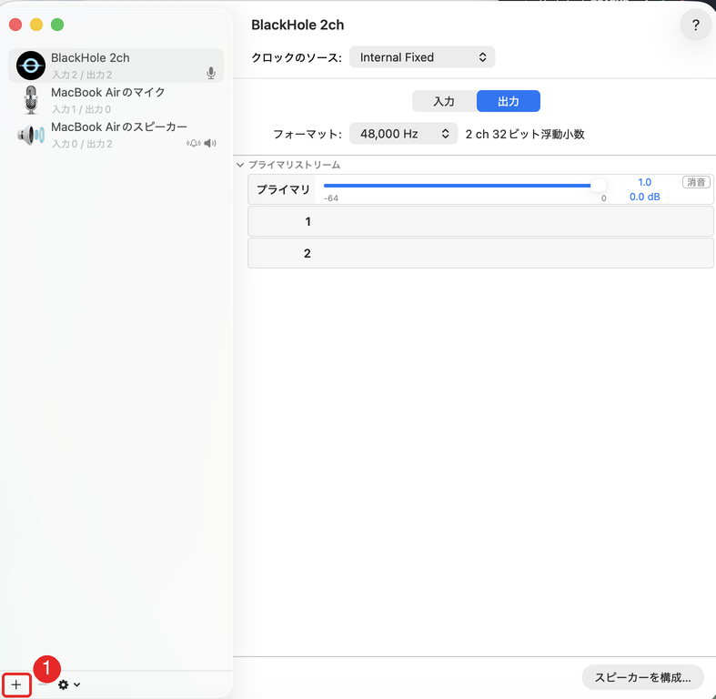
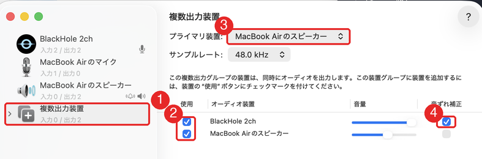
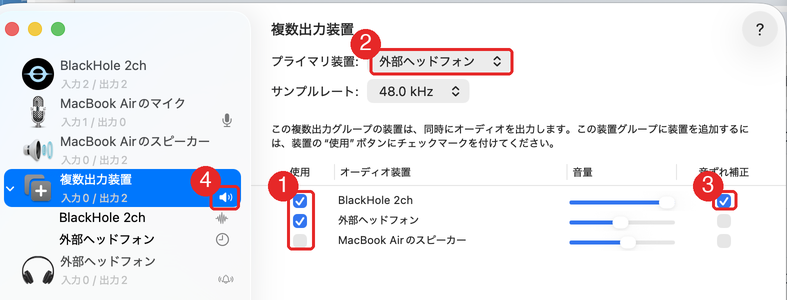

# macOS のセットアップ

[English](macos-setup.md)

macOS で shadow-clerk を使い、**自分の声（マイク）** と **相手の声（会議アプリの音）** の両方を文字起こしするための手順です。

## しくみ

macOS には「他のアプリが鳴らしている音を録る」機能がありません。そこで **BlackHole** という仮想オーディオデバイスを入れ、Mac の音をイヤホン（スピーカー）と BlackHole の両方に流します。shadow-clerk は BlackHole を「相手の声」として録ります。



「複数出力装置」は、1 つの音を複数の装置に同時に流すための macOS の機能です。

## 手順 1: 必要なソフトを入れる

ターミナルで順に実行します。

```bash
# 1. git（Command Line Tools）。ダイアログが出たら「インストール」
xcode-select --install

# 2. Homebrew。途中で Mac のログインパスワードを聞かれる
/bin/bash -c "$(curl -fsSL https://raw.githubusercontent.com/Homebrew/install/HEAD/install.sh)"
#    最後に表示される「Next steps」の 2 行を実行して brew を使えるようにする

# 3. uv と Python
curl -LsSf https://astral.sh/uv/install.sh | sh
#    ここでターミナルのウィンドウを開き直す
uv python install 3.13

# 4. BlackHole。途中でパスワードを聞かれる
brew install blackhole-2ch

# 5. Mac のオーディオを再起動して BlackHole を認識させる（一瞬音が途切れる）
sudo killall coreaudiod
```

## 手順 2: 複数出力装置を作る

1. **Audio MIDI 設定** を開く。システム設定の項目ではなく、**アプリケーション → ユーティリティ** にある別のアプリです（Spotlight で「Audio MIDI」と入力しても開けます）
2. 左の一覧に **BlackHole 2ch** があることを確認し、左下の **＋**（①）→ **複数出力装置を作成** を選ぶ



3. 左の一覧に増えた **複数出力装置**（①）を選び、右側を次のように設定する



| 番号 | 設定 |
|------|------|
| ② | 「使用」の列で **BlackHole 2ch** と **MacBook Air のスピーカー** にチェック |
| ③ | **プライマリ装置** をスピーカーにする（自分が聞く装置を基準にする） |
| ④ | **BlackHole 2ch** の **音ずれ補正** にチェック（プライマリ装置の行はグレーになり、チェックできない） |

> 古い macOS では「プライマリ装置」は「主装置」、「音ずれ補正」は「ドリフト補正」と表示されます。

## 手順 3: 出力と入力を選ぶ

Audio MIDI 設定の左の一覧で、次の 2 つを右クリックします。

- **複数出力装置** → **このサウンド出力装置を使用**
- **MacBook Air のマイク** → **このサウンド入力装置を使用**

BlackHole を入れた直後は、macOS が **入力を BlackHole に切り替えてしまう** ことがあります。入力が BlackHole のままだと、shadow-clerk は自分の声を録れません（ログに「マイクに monitor 用のデバイス BlackHole 2ch が選ばれています」と警告が出ます）。

正しく設定できると、左の一覧で **スピーカーのアイコンが「複数出力装置」の横** に、**マイクのアイコンが「MacBook Air のマイク」の横** に付きます。

複数出力装置を使っている間は **キーボードの音量キーが効きません**。音量は Audio MIDI 設定で装置ごとに調整します。

## 手順 4: イヤホンを使う場合

会議では **イヤホン（ヘッドホン）を推奨** します。スピーカーだと相手の声をマイクが拾い、「自分」の欄にも同じ発言が入ってしまいます。

イヤホンをつなぐと、macOS は **出力を自動でイヤホンに切り替えます**。複数出力装置を経由しなくなるので、BlackHole に音が届かず、相手の声が文字起こしされなくなります。複数出力装置にイヤホンを加え、選び直してください。



| 番号 | 設定 |
|------|------|
| ① | 「使用」の列で **BlackHole 2ch** と **外部ヘッドフォン** にチェック。**スピーカーのチェックは外す**（外さないとスピーカーからも音が出る） |
| ② | **プライマリ装置** を **外部ヘッドフォン** にする |
| ③ | **BlackHole 2ch** の **音ずれ補正** にチェック |
| ④ | 複数出力装置を右クリック → **このサウンド出力装置を使用**。スピーカーのアイコンがこの行に付けば OK |

イヤホンを **抜き差しするたびに、macOS は出力を切り替えます**。抜き差ししたら、メニューバーのサウンドアイコン（またはコントロールセンター）で **複数出力装置** を選び直してください。

スピーカーとイヤホンを行き来するなら、複数出力装置を 2 つ作っておくと切り替えが楽です（「スピーカー + BlackHole」と「イヤホン + BlackHole」）。名前をダブルクリックすると、分かりやすい名前に変えられます。

## 手順 5: shadow-clerk を入れて起動する

```bash
uv tool install shadow-clerk
clerk-daemon --list-devices
```

`--list-devices` の最後に `[自動検出] sounddevice monitor: device #<番号>` と出れば、BlackHole を相手の声として使う準備ができています。

`~/.local/share/shadow-clerk/config.yaml` に次の 1 行を足します。Mac のキーボードには既定の Push-to-Talk キー（`f23`）が無いためです。

```yaml
voice_command_key: alt_r   # 右 Option キー。Push-to-Talk を使わないなら null
```

起動してダッシュボード <http://localhost:8765> を開きます。

```bash
clerk-daemon
```

初回は次の許可を求められます（**システム設定 → プライバシーとセキュリティ**）。

| 許可 | 必要な場面 |
|------|------------|
| マイク | 常に（起動したターミナルに許可） |
| アクセシビリティ・入力監視 | Push-to-Talk を使うとき |
| 画面収録 | ブラウザ拡張で画面全体のスクリーンショットを撮るとき |

## 困ったとき

| 症状 | 原因と対処 |
|------|------------|
| 相手の声が文字起こしされない | 出力が複数出力装置になっていない（イヤホンの抜き差しで切り替わった）。メニューバーで **複数出力装置** を選び直す |
| 自分の声が文字起こしされない | 入力が BlackHole になっている。**MacBook Air のマイク** を入力にする |
| 「自分」の欄に相手の声も入る | スピーカーの音をマイクが拾っている。イヤホンを使い、複数出力装置からスピーカーを外す |
| `--list-devices` に BlackHole が出ない | `sudo killall coreaudiod` を実行するか、Mac を再起動する |
| 音量キーで音量が変わらない | 複数出力装置の仕様。Audio MIDI 設定で装置ごとに調整する |
| ログに `voice_command_key 'f23' を解決できません` | `config.yaml` の `voice_command_key` を `alt_r` か `null` にする |

いまの出力と入力は、ターミナルでも確認できます。`Default Output Device: Yes` が **複数出力装置** に、`Default Input Device: Yes` が **マイク** に付いていれば正しい状態です。

```bash
system_profiler SPAudioDataType | grep -E ":$|Default (Output|Input) Device"
```
