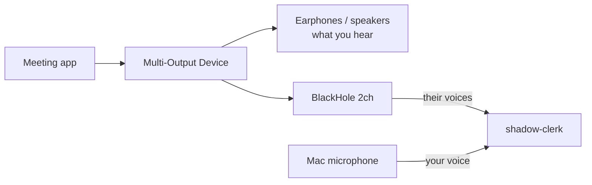
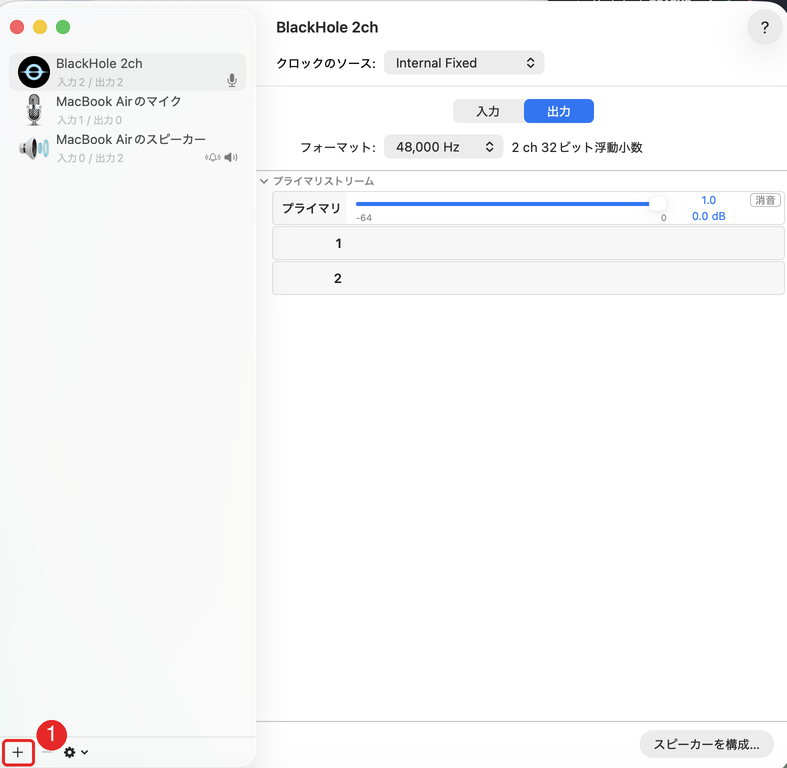
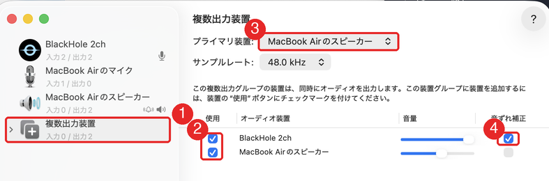
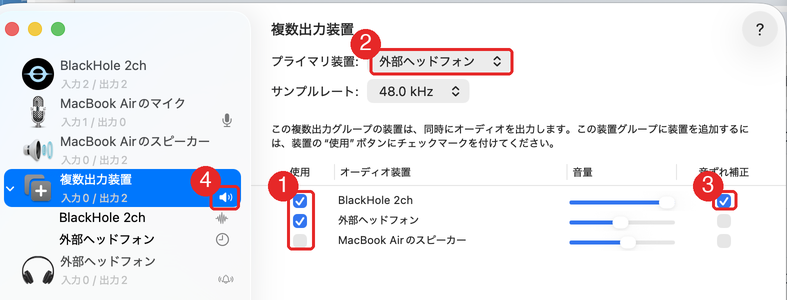

# macOS setup

[日本語](macos-setup.ja.md)

This guide sets up shadow-clerk on macOS so it transcribes both **your voice (microphone)** and **the other participants (the meeting app's audio)**.

## How it works

macOS has no way to record what other apps play. You install **BlackHole**, a virtual audio device, and send the Mac's sound to both your earphones (or speakers) and BlackHole. shadow-clerk records BlackHole as the other participants' voices.



A Multi-Output Device is a macOS feature that plays the same sound on several devices at once.

The screenshots below are from a Mac set to Japanese; the English labels are given in the text.

## Step 1: Install the software

Run these in Terminal, one at a time:

```bash
# 1. git (Command Line Tools). Choose "Install" in the dialog
xcode-select --install

# 2. Homebrew. Asks for your login password
/bin/bash -c "$(curl -fsSL https://raw.githubusercontent.com/Homebrew/install/HEAD/install.sh)"
#    Then run the two commands it prints under "Next steps"

# 3. uv and Python
curl -LsSf https://astral.sh/uv/install.sh | sh
#    Open a new Terminal window here
uv python install 3.13

# 4. BlackHole. Asks for your password
brew install blackhole-2ch

# 5. Restart Core Audio so BlackHole shows up (sound cuts out for a moment)
sudo killall coreaudiod
```

## Step 2: Create a Multi-Output Device

1. Open **Audio MIDI Setup**. It is a separate app in **Applications → Utilities**, not a pane of System Settings (or type "Audio MIDI" in Spotlight)
2. Check that **BlackHole 2ch** is in the list on the left, then click **+** at the bottom left (①) → **Create Multi-Output Device**



3. Select the new **Multi-Output Device** (①) and set up the right side:



| # | Setting |
|---|---------|
| ② | In the **Use** column, tick **BlackHole 2ch** and **MacBook Air Speakers** |
| ③ | Set **Primary Device** to the speakers (the device you listen on) |
| ④ | Tick **Drift Correction** for **BlackHole 2ch** (the primary device's box is greyed out) |

## Step 3: Choose the output and input

In the list on the left of Audio MIDI Setup, right-click:

- **Multi-Output Device** → **Use This Device For Sound Output**
- **MacBook Air Microphone** → **Use This Device For Sound Input**

Right after BlackHole is installed, macOS may **switch the input to BlackHole**. If it stays there, shadow-clerk cannot record your voice (the log warns that a monitor device was chosen as the microphone).

When it is right, the speaker icon sits next to **Multi-Output Device** and the microphone icon next to **MacBook Air Microphone** in the list.

The **volume keys do not work** while a Multi-Output Device is the output. Set the volume per device in Audio MIDI Setup.

## Step 4: Using earphones

**Earphones (or headphones) are recommended** for meetings. With speakers, the microphone picks up the other participants and their words also appear under your own name.

When you plug in earphones, macOS **switches the output to them directly**. Sound no longer goes through the Multi-Output Device, BlackHole gets nothing, and the other participants stop being transcribed. Add the earphones to the Multi-Output Device and select it again:



| # | Setting |
|---|---------|
| ① | In **Use**, tick **BlackHole 2ch** and **External Headphones**. **Untick the speakers**, or sound also comes out of them |
| ② | Set **Primary Device** to **External Headphones** |
| ③ | Tick **Drift Correction** for **BlackHole 2ch** |
| ④ | Right-click the Multi-Output Device → **Use This Device For Sound Output**. The speaker icon moves to this row |

**Every time you plug or unplug the earphones, macOS switches the output.** Afterwards, pick **Multi-Output Device** again from the sound icon in the menu bar (or Control Center).

If you switch between speakers and earphones often, create two Multi-Output Devices ("Speakers + BlackHole" and "Earphones + BlackHole"). Double-click a name to rename it.

## Step 5: Install and start shadow-clerk

```bash
uv tool install shadow-clerk
clerk-daemon --list-devices
```

When the last line reads `[Auto-detect] sounddevice monitor: device #<number>`, BlackHole is ready to be used for the other participants.

Add this line to `~/.local/share/shadow-clerk/config.yaml`. Mac keyboards have no key for the default Push-to-Talk setting (`f23`):

```yaml
voice_command_key: alt_r   # right Option key; null to disable Push-to-Talk
```

Start the daemon and open the dashboard at <http://localhost:8765>:

```bash
clerk-daemon
```

macOS asks for these permissions the first time (**System Settings → Privacy & Security**):

| Permission | When it is needed |
|------------|-------------------|
| Microphone | Always (grant it to the terminal you start from) |
| Accessibility, Input Monitoring | Push-to-Talk |
| Screen Recording | Whole-screen screenshots from the browser extension |

## Troubleshooting

| Symptom | Cause and fix |
|---------|---------------|
| The other participants are not transcribed | The output is not the Multi-Output Device (plugging in earphones switched it). Pick **Multi-Output Device** again in the menu bar |
| Your own voice is not transcribed | The input is BlackHole. Make **MacBook Air Microphone** the input |
| The other participants also appear under your name | The microphone hears the speakers. Use earphones and remove the speakers from the Multi-Output Device |
| BlackHole is missing from `--list-devices` | Run `sudo killall coreaudiod` or restart the Mac |
| The volume keys do nothing | A Multi-Output Device limitation. Adjust each device in Audio MIDI Setup |
| The log says `voice_command_key 'f23'` cannot be resolved | Set `voice_command_key` to `alt_r` or `null` in `config.yaml` |

To check the current output and input from Terminal: `Default Output Device: Yes` should be on **Multi-Output Device** and `Default Input Device: Yes` on the **microphone**.

```bash
system_profiler SPAudioDataType | grep -E ":$|Default (Output|Input) Device"
```
